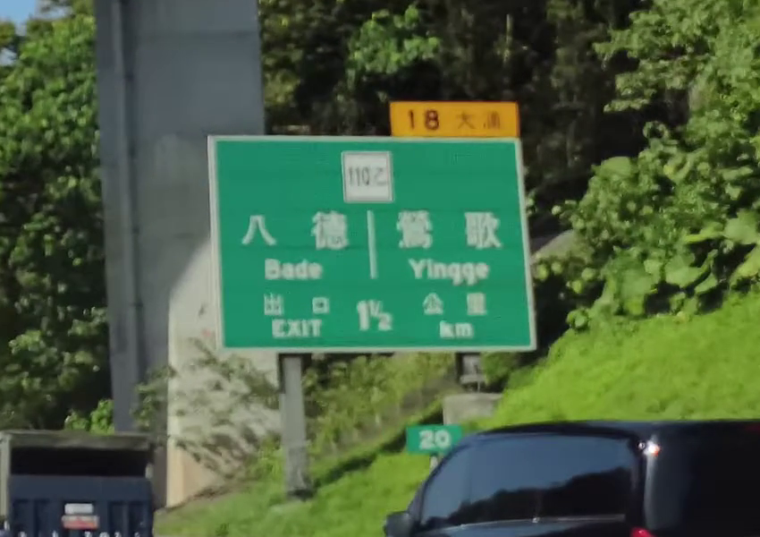
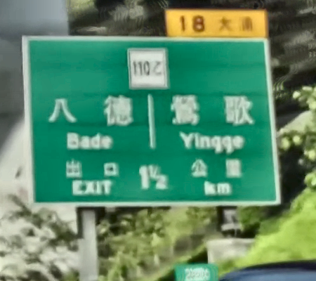
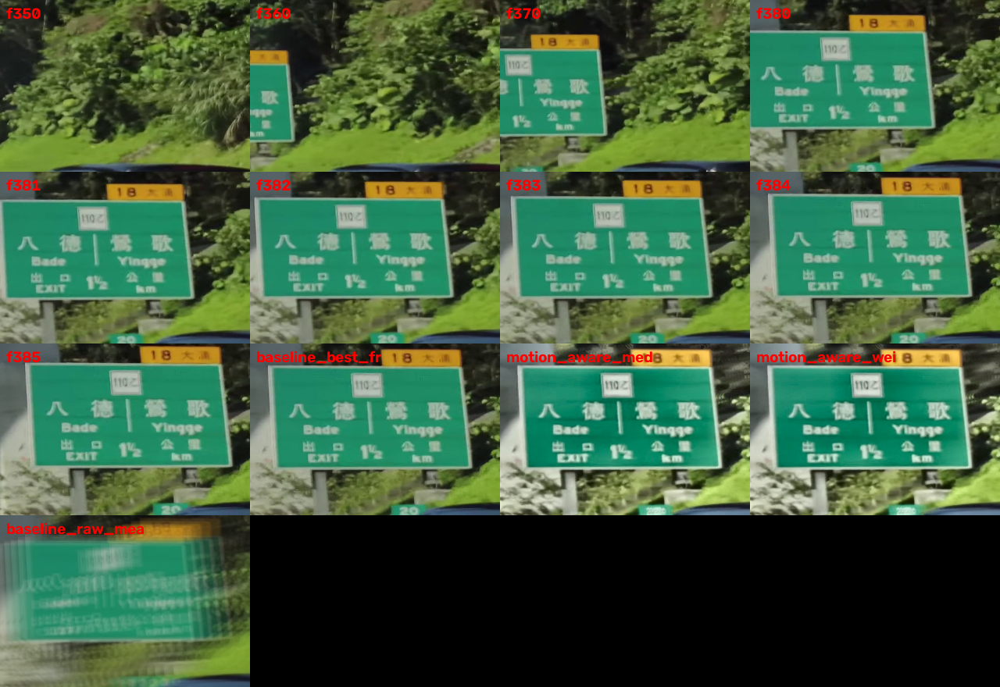
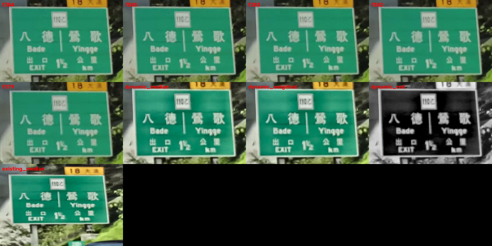
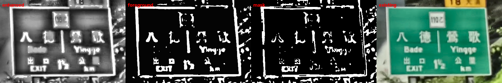
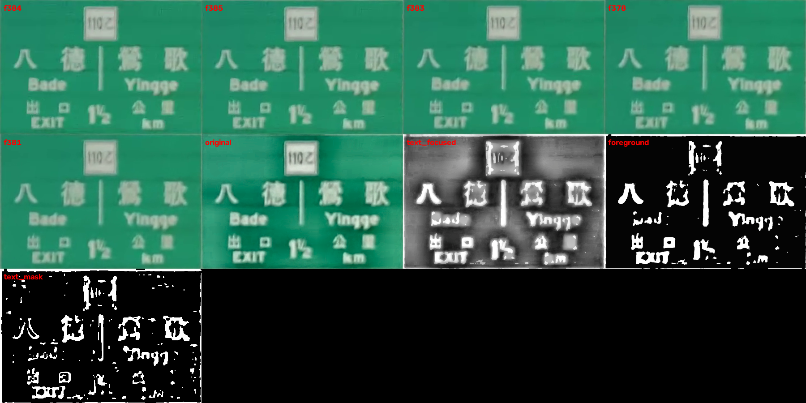
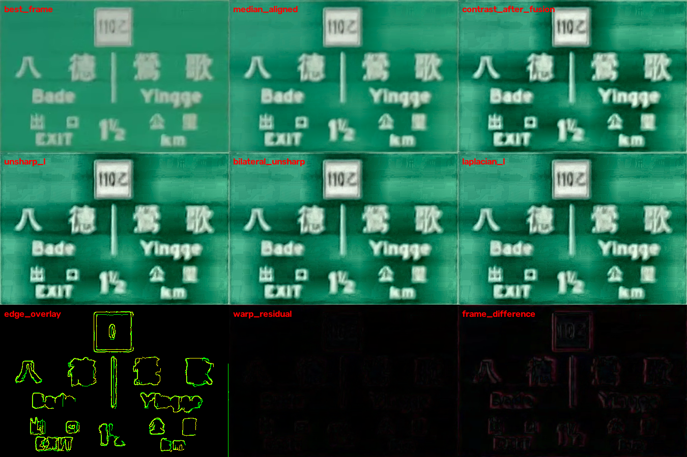
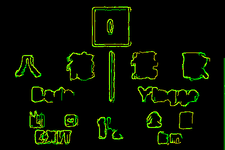
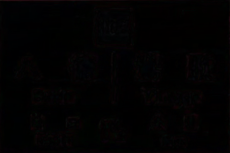

# 路牌多幀提取與 preprocess 專題報告

## 1. 摘要

本專題的目標是從 `data/road.mp4` 擷取可供 preprocess/OCR 使用的台灣路牌影像。原始影片中的路牌不是可靠的 COCO/YOLO 類別，且路牌在畫面中持續放大、位移並受到運動模糊與低解析度限制。因此流程從「車輛偵測」逐步改為「路牌表面候選 → 動態追蹤 → canonical rectification → 品質選幀 → 對位後 robust fusion → 保守對比增強」。

**目前最適合當主結果的是 contrast-only 的 `contrast_after_fusion.png`**：它保留彩色，只在 Lab 的 L 通道做適度 CLAHE/gamma；沒有把二值前景 mask 或高 Laplacian 數值誤當成真實細節恢復。銳化比較沒有證明能可靠恢復缺失筆畫，因此沒有取代 contrast-only。

## 2. 資料與可重現性

來源只有 `data/road.mp4`：

| 欄位 | 實測值 |
|---|---:|
| frame count | 390 |
| FPS | 30 |
| 解析度 | 3840 × 2160 |
| 時長 | 約 13 秒 |
| 路牌分析範圍 | frame 350–385，共 36 幀 |

報告中的生成物原本位於被 `.gitignore` 排除的 `outputs/`，避免把大量中間影像提交到 repository。本報告只複製少量代表性證據到 [`assets/`](assets/)；每張圖都由原始影片或既有 manifest 的實跑流程產生。

原始路牌幀：

## 3. YOLO probe 與 fallback

本機 `yolo11n.pt` 是通用 COCO checkpoint。實際 probe 得到 `car=22`、`truck=4`，沒有 generic road-sign 類別，因此沒有宣稱 YOLO 能辨識本專案的台灣路牌，也沒有用 YOLO 結果建立路牌 track。

改用可驗證、可重現但非通用模型的 HSV 藍綠路牌表面候選：

- morphology close + contour candidate；
- 在指定影片區域搜尋；
- 以跨幀位置與路牌面積建立穩定候選；
- manifest 明確記錄 detector 是 fallback，而不是訓練完成的路牌模型。

限制是顏色、視角與場景改變時可能失效；產品化仍需專用路牌資料與權重。

## 4. 版本演進與實測結果

### 4.1 初版候選追蹤與 stable track

`feature/sign-candidate-tracking` 將 COCO 類別處理與 HSV/形狀 fallback 放在 `preprocess/eval/track_source.py`。成功找到 `track_-2` 的真實路牌片段，之後建立 `track_real_sign`，保留 frame 350–385 的 36 幀。

早期固定 crop 的問題是框選過大、混入車輛/樹葉，且早期幀左側路牌內容可能被切掉。這也是後續改用動態 bbox 的原因。

### 4.2 固定 ROI、ECC、CLAHE、median/weighted fusion

`feature/motion-aware-fusion` 與 `feature/road-sign-evaluation` 完成既有 preprocess 契約：

- `passthrough`、`best_frame`、`enhance`、`fusion`；
- ECC 對位、motion quality、occlusion proxy、pixel confidence；
- median 與 confidence-weighted mean；
- fusion 失敗時回到 passthrough；
- 不把未對位 raw mean 當 final。

舊版 motion-aware manifest 的代表數字：

| 輸出 | sharpness | edge density |
|---|---:|---:|
| baseline best frame (frame 384) | 2779.77 | 0.0575 |
| motion-aware median | 5900.58 | 0.0805 |

數值顯示對位後融合比單幀穩定，但不代表新增了原始影片不存在的字筆畫。

### 4.3 blur/diagnosis 與 external analysis audit

診斷流程對原始影片與輸出計算 Laplacian、FFT high-frequency、局部對比、SNR、光流、ECC residual、遮擋 proxy，並產生接觸表：

`diagnosis.json` 的優先級：

| 根因 | 判斷 |
|---|---|
| 原始資訊/解析度限制 | not proven |
| 運動模糊 | medium candidate; await axis-aligned edge spread |
| 失焦或低細節 | medium |
| ROI/對位 | medium |
| 遮擋 | low–medium |
| rolling shutter | not proven |
| 壓縮 | low |

外部分析指出「平行線可能是多幀錯位」，因此後續用原始影片重測，而不是直接接受。audit 確認以下現象：frame 350→385 路牌寬度約由 184 px 增至 357 px、固定 crop 早期會切字、全窗 sharpness 可能選到背景較清楚的錯誤幀、frame 384 確實應納入候選。另一方面，decode hash 沒有重複幀證據，rolling shutter 也沒有被證明。

### 4.4 dynamic sign

`run_dynamic_sign.py` 改為逐幀動態 bbox、canonical 450×300、sign-only ECC、路牌 ROI sharpness 選幀。實測選用：

`[384, 385, 383, 382, 379]`

median output 的 manifest 數字：

- gray sharpness：5586.47；
- gray Laplacian：76.63；
- red-channel Laplacian：119.60；
- edge density：0.07064；
- ECC correlation 約 0.961–0.993。

這版修正了固定 crop 與背景主導的主要風險，但仍受原始運動模糊與像素尺寸限制。

### 4.5 text separation/foreground 分支

`run_text_separation.py` 測試：

- R channel；
- glare mask 與 Telea inpainting；
- Gaussian illumination correction；
- CLAHE；
- white top-hat；
- adaptive threshold；
- text-focused soft image 與 foreground mask。

text-enhanced median 的指標為 sharpness 14345.42、Laplacian 555.73、edge density 0.08506、估計前景/背景對比 97.71。這些數值證明「視覺分離」變強，但 binary mask 也會把邊框、亮葉或噪聲當成前景；高 Laplacian 可能只是增強/二值化造成。因此：

- `text_enhanced_median.png` 可作文字可讀性實驗；
- `foreground_mask_median.png` 只作輔助診斷；
- 不作原彩 final，也不宣稱恢復真實筆畫。

### 4.6 從零重建 pipeline

`feature/from-scratch-road-sign-pipeline` 的 `rebuild_pipeline.py` 只讀 `data/road.mp4`，重新完成 metadata、YOLO probe、HSV fallback、動態 bbox、四角 homography、ROI 品質選幀、sign-only ECC median fusion 與文字分支。

36/36 幀偵測成功，選用：

`[384, 385, 383, 378, 381]`

原彩 canonical median：

- sharpness 2780.96；
- Laplacian 47.44；
- edge density 0.05207；
- 估計前景/背景對比 31.49。

### 4.7 contrast-only

使用者要求不要把前景/背景 mask 當主結果，因此 `feature/contrast-only-diagnostics` 改為只保留彩色：

1. 最佳單幀；
2. canonical 對位後短窗 median；
3. median 後對 Lab L 通道做適度 CLAHE/gamma。

實測選用：

`[385, 384, 383, 376, 375]`

| 輸出 | sharpness | local contrast | edge density |
|---|---:|---:|---:|
| best frame | 971.19 | 25.38 | 0.02622 |
| aligned median | 2816.88 | 39.87 | 0.05264 |
| contrast after fusion | 5423.95 | 52.16 | 0.06535 |

### 4.8 平行線假設與銳化比較

contrast-only 同時輸出：

- `edge_overlay.png`：各幀邊緣與 reference 重疊；
- `warp_residual.png`：對位後與 reference 的殘差；
- `frame_difference.png`：短窗兩端差分；
- directional FFT。

實測證據：

- ECC correlation：1.000、0.9941、0.9902、0.9891、0.9871；
- 平均 warp residual：2.201/255；
- edge disagreement：0.02088；
- edge IoU mean：0.4274；
- FFT anisotropy：1.154。

因此目前**不支持「大量平行線主要來自多幀錯位」**。較保守的解釋是單幀運動/失焦、尺度/透視變化，或銳化 halo；錯位仍是需要監控的次要因素。

另比較 Lab CLAHE、L-channel USM、bilateral+USM、限制性 Laplacian：

| 方法 | local contrast | halo ratio | temporal std | 結論 |
|---|---:|---:|---:|---|
| Lab CLAHE | 42.59 | 0 | 3.347 | **保留為 primary** |
| USM | 43.11 | 0.00036 | 3.648 | rejected：halo/幀間變異增加 |
| bilateral + USM | 42.79 | 0 | 3.580 | rejected：沒有可靠 edge gain |
| constrained Laplacian | 43.21 | 0 | 3.903 | rejected：幀間變異最大 |

銳化後邊緣看起來更硬，不等於找回不存在的字筆畫；因此目前不把任何銳化版列為 final。

### 4.9 最新 diagnostics：leave-one-out 與資訊上限重評

`outputs/diagnostics/diagnosis.json` 與 `diagnosis_report.md` 的最新結果只重新量測原始幀及既有輸出，沒有新增 fusion/enhancement 圖，也沒有修改 pipeline。leave-one-out 仍是「各原始 crop resize 到 frame 385 尺寸」的 proxy：單候選平均 PSNR `17.0808` dB、SSIM `0.5032`，前後半序列互相比較為 PSNR `18.7077` dB、SSIM `0.6131`。但 frame 350→385 的路牌尺度約由 `184` px 增至 `357` px，候選間還有 bbox 尺度、透視與插值差異；因此這些數字只能表示幀間內容/幾何差異，不能把 PSNR/SSIM 或高頻平均 `3.1312` 歸因為融合後新增真實高頻。原 leave-one-out 對「多幀融合增加真實解析度」最多是**弱、混淆未排除的證據**，本報告降級為不支持該宣稱；可支持的說法是對位後融合可能帶來穩定化或降噪。

交叉證據目前不足以證實「原始影片形成資訊上限」：原始 ROI 徑向頻譜 cutoff 約 `0.3545–0.4077` cycles/pixel（操作性 threshold，不是 MTF）；edge spread 的有效統計為垂直 sigma 中位數 `4.2150` px、10–90 寬度 `10.8036` px，水平 sigma `0.2754` px、寬度 `0.7060` px。量測直接使用原始 full-frame 灰階，沒有插值、二值化或銳化，但 bbox 外框與中線仍是未校正整數座標，因此方向性異常必須等待軸向 edge spread 複核。診斷 overlay 與逐幀 sigma/10–90 表在 `outputs/diagnostics/edge_spread_overlay_frame_385.png`、`diagnosis.json`、`frame_measurements.csv`。

光流統計明確分開：相鄰幀路牌區域位移 median=`6.86–15.50` px/frame，mean=`6.01–12.54` px/frame；拖尾使用 `flow × 30 × exposure`，1/60、1/120、1/250 秒分別為 mean `3.01–6.27`、`1.50–3.13`、`0.72–1.50` px，median `3.43–7.75`、`1.72–3.88`、`0.82–1.86` px。曝光未知，所以全是情境估計，不能混用 mean 與 median。降採樣後 bicubic round-trip 在 2×/3×/4×/6× 的 PSNR/SSIM 為 `43.88/0.993`、`39.72/0.982`、`37.02/0.967`、`33.26/0.928`；這是可近似保留性的操作性測試，不是真實感測器解析度。

OCR 只作下游可用性證據：最新 RapidOCR 在 36 個 raw crops 的平均命中數為 `1.61/10`，2×/3× bicubic 分別為 `1.61/10`、`1.58/10`；canonical 單幀（不融合）為 `4/10`，canonical median（不做 CLAHE）為 `3/10`，既有完整 pipeline 為 `4/10`。每個輸入的文字、confidence、10 項 hit table、大字/小字統計與控制條件均在 `outputs/diagnostics/diagnosis.json` 與 `diagnosis_report.md`；2×/3× 僅作 OCR 輸入，沒有新增視覺增強 final。綜合 OCR、edge spread、flow/trail、頻譜與有效解析度結果，最新判定表如下：

| 問題 | 最新結論 | 證據強度 | 主要依據與限制 |
|---|---|---|---|
| 原始影片是否形成資訊上限？ | 未證實 | 未證實 | 頻譜、筆畫尺寸與 round-trip 只是操作性證據；edge spread 方向性與座標風險仍待軸向複核 |
| leave-one-out 能否證明多幀融合增加真實解析度？ | 不能；降級為弱證據，結論維持不支持宣稱 | 弱 | raw-crop resize proxy 的 PSNR/SSIM 混入尺度、透視與插值；沒有共同物理座標下的獨立高頻新增證據 |
| 多幀融合目前可合理主張什麼？ | 穩定化/降噪的候選效果，不是真實解析度恢復 | 中 | 既有對位與融合輸出較穩定，但 OCR 命中差異非盲測、且未排除選幀/尺度因素 |
| 主要模糊或變異來源 | 運動、失焦/低有效細節、尺度變化仍是候選 | 中（待軸向 edge spread） | flow mean/median 與情境拖尾已分開；方向性 edge spread 尚不能直接歸因 |
| OCR 是否顯示下游可用性？ | 有限支持「部分文字可讀」，不支持解析度提升 | 中 | raw `1.61/10`，best/median/contrast `3/10`、`3/10`、`4/10`；真值是假設且輸入流程不同 |

## 5. 目前結論

1. **偵測**：通用 COCO YOLO 不足以辨識本路牌；HSV fallback 對本片有效，但不是通用 detector。
2. **取樣**：動態 bbox、canonical rectification 與短窗品質選幀比固定 crop 更可靠。
3. **融合**：sign-only ECC + median 比未對位 raw mean 穩定；weighted 不是在所有幀都優於 median。
4. **文字分離**：可提升字與綠底的視覺對比，但 mask/二值化不能當原彩 final。
5. **對比增強**：Lab-L CLAHE/gamma 是目前最穩健的低風險主結果。
6. **銳化**：目前只有視覺邊緣變硬，沒有足夠證據證明真實細節改善；保留為 rejected evaluation。
7. **證據限制**：最新 diagnostics 尚未證實原始影片形成硬資訊上限；運動/失焦仍是中等候選，需軸向 edge spread 複核。leave-one-out 受尺度/插值混淆，不能宣稱多幀融合增加真實解析度。傳統增強仍不能保證恢復小筆畫，也不能用高 Laplacian、OCR 命中或超解析視覺效果替代共同座標與保留幀驗證。

## 6. 下一步改善方向（優先級）

### P0：改善輸入與驗證

- 取得原始碼率更高、未經二次壓縮的影片；
- 延長追蹤視窗，從路牌更大且未離焦的位置取樣；
- 對每幀保存 source bbox、canonical transform、sharpness、ECC correlation 與 reject reason；
- 以 OCR CER/字元一致性作主指標，不能只看 Laplacian。

### P1：更可靠的路牌模型與幾何

- 收集台灣路牌標註資料，訓練/驗證專用 detector；
- 用路牌四角、邊線與局部 feature/optical flow 做亞像素 homography；
- 對尺度快速變化時縮短 fusion window，避免把不同尺度硬融合；
- 對遮擋與低 correlation 像素做 confidence gating。

### P2：保守 restoration 研究

- 在合成資料上先驗證已知 blur kernel 的 restoration；
- 比較 TV/Richardson–Lucy 或影片去模糊模型，但必須用保留幀預測誤差與 OCR 一致性防止幻覺；
- 若引入超解析，輸出必須標註為視覺增強，不可當作真實字形證據。

## 7. Git 分支與 commit 對照

| Branch | Commit | 內容 |
|---|---|---|
| `master` | `cfb4df7` | 忽略模型權重與生成物，保留可用基線 |
| `feature/sign-candidate-tracking` | `c11f200` | COCO 類別處理、HSV/形狀候選與 stable track |
| `feature/motion-aware-fusion` | `10c81ea` | ECC、motion quality、weighted/median fusion |
| `feature/road-sign-evaluation` | `e1f320d` | blur、diagnosis、dynamic/text evaluation |
| `feature/from-scratch-road-sign-pipeline` | `6d523c0` | 只讀原始 MP4 的完整重建流程 |
| `feature/contrast-only-diagnostics` | `45c5299` | contrast-only、平行線診斷與保守銳化比較 |
| `docs/project-report` | 本報告 commit | 專題報告與精選實跑證據 |

## 8. 測試狀態

目前完整 pytest：**26 passed**。`git diff --check` 通過。報告資產只包含精選圖與 manifest 副本，沒有提交影片、模型權重、zip 或完整 36 幀輸出。
