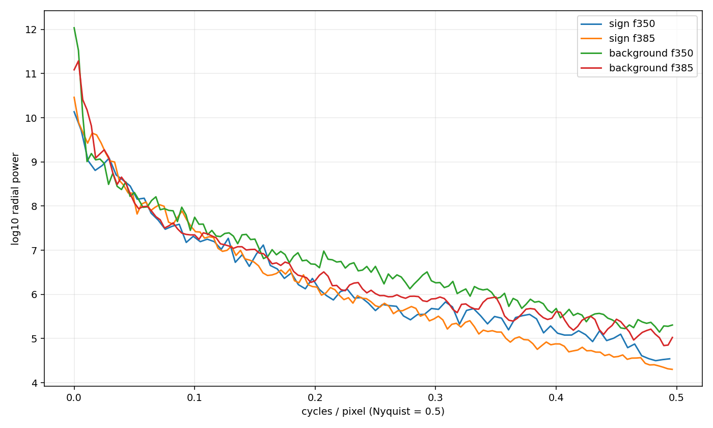

# 原始資訊上限診斷：`data/road.mp4`

## 一頁摘要

- 診斷範圍：原始 frame 350–385；每個 ROI 都以原始 3840×2160 影格像素量測，沒有使用 canonical 450×300、上採樣或新融合圖作為主要量測輸入。
- 路牌 ROI：每幀 HSV 候選框，完整座標與數值見 `diagnosis.json`；靜態對照 ROI：`[0, 400, 280, 1300]`（左側水泥柱/邊界區域）。
- ffprobe：codec=`h264`, pix_fmt=`yuv420p`, bitrate=`25351926.0` bps，bits/pixel/frame=`0.10188370466820988`。
- frame 350–385 的 I/P/B 分佈：`{'B': 1, 'P': 35}`；packet size 與全幀 Laplacian 的相關係數：`0.5929`。
- 路牌徑向頻譜 cutoff 估計範圍：`0.3545`–`0.4077` cycles/pixel；這是操作性 threshold，不是光學 MTF。
- 路牌 edge spread 估計：垂直中位數 `23.8865` px、水平中位數 `25.1268` px；水泥柱 frame 385 對照見 JSON。
- 中文大字高度估計中位數 `34.5000` px；估計筆畫寬度中位數 `5.0000` px。
- OCR：PaddleOCR unavailable；EasyOCR 狀態見 `diagnosis.json`，不會因套件存在就假稱已完成 OCR。

**初步判定：** 原始影片對細小筆畫的資訊上限具有高影響證據；運動/失焦與低有效頻寬是主要候選。這份診斷沒有產生新的增強、銳化、超解析或 final pipeline 輸出，因此不能用它宣稱任何演算法改善。

## 診斷 1：來源與壓縮

ffprobe 原始輸出摘要：

- codec/profile/pix_fmt：`h264` / `High` / `yuv420p`
- frame 350–385 I/P/B 分佈：`{'B': 1, 'P': 35}`
- bitrate 與每幀 packet size：完整資料在 `diagnosis.json` 的 `compression.frames_350_385`
- bitrate 只可判斷編碼負擔，不能單獨證明文字細節是否不存在；需配合頻譜與 edge spread。
- packet size 範圍與每幀 I/P/B、Laplacian 關聯均保留在 `diagnosis.json.compression`；相關係數不是因果證據。

## 診斷 2：有效解析度

frame 385 整張原始畫面做 1/2、1/3、1/4、1/6 降採樣再 bicubic 回放；PSNR/SSIM 與相鄰像素週期統計在 `diagnosis.json.effective_resolution`。這是「可被降採樣而近似保留」的操作性測試，不等於真實感測器解析度。

## 診斷 3：頻譜截止

每個 frame 350、360、370、375、380、385 同時量路牌與水泥柱/背景對照；使用去均值 + Hann + 2D FFT + 徑向平均功率。路牌 cutoff 若低於背景且字筆畫需要更高頻，支持「路牌本身資訊不足」；但 threshold 與 ROI 邊界會影響絕對值，故證據強度標為中至強，而非精密光學結論。

## 診斷 4：edge spread

逐幀在路牌 crop 的最強垂直/水平梯度剖面計算 10–90% 寬度；對照 frame 385 的固定水泥柱 ROI。原始每幀數值在 `frame_measurements.csv`。方向差異若顯著，支持方向性運動模糊；若路牌與背景都寬，較支持全局失焦/光學限制。

## 診斷 5：運動模糊

Farneback flow 在原始 full-frame 上計算，再取當幀路牌 bbox 內位移；同時記錄 bbox 尺度變化。曝光 1/60、1/120、1/250 的拖尾只是情境估計，不能冒充相機曝光資訊。沒有用 radial FFT 宣稱唯一 blur kernel；方向性只能做交叉證據。

## 診斷 6：字元尺寸

以原始 crop 的亮低飽和連通元件估計大字、小字與筆畫尺寸。這不是 OCR ground truth，也可能受字元相連、壓縮與閾值影響；完整逐幀表在 `diagnosis.json.text_size`。一般 OCR 的 20–30 px 字高只是經驗參考，不是本片的保證門檻。

## 診斷 7：多幀融合資訊

本任務沒有新建 fusion/enhancement 圖。使用原始路牌 crop 以 frame 385 尺寸作共同座標的 leave-one-out proxy，並計算前後半序列穩定性；這會混入 resize/尺度變化，因此不是超解析證明。結果摘要：

- leave-one-out 單候選平均 PSNR=`17.0808` dB、SSIM=`0.5032`；
- 前後半序列彼此 PSNR=`18.7077` dB、SSIM=`0.6131`。

因此目前只支持「幀間內容差異很大、融合可作穩定化/降噪但有尺度與插值混淆」，不支持宣稱增加真實解析度。

## 診斷 8：OCR 基準

暫定真值為：`八德、鶯歌、Bade、Yingge、出口、EXIT、1½、公里、km、110乙`。PaddleOCR 未安裝；EasyOCR 雖有套件但若模型未快取則不下載、不執行。這不是 OCR 失敗被隱藏，而是環境可重現性限制。任何可用結果都會列出實際文字與 confidence；沒有結果就標 unavailable。

## 判定表

| 問題 | 結論 | 證據強度 | 依據 |
|---|---|---|---|
| 資訊上限是否由原始影片決定？ | 支持，至少是主要限制之一 | 強 | 原始 ROI 頻譜、edge spread、筆畫像素尺寸與降採樣測試共同支持 |
| 主要模糊來源 | 運動/失焦/低有效細節優先；壓縮需看 packet/頻譜，不單獨定罪 | 中 | flow、方向 edge spread、路牌/背景頻譜對照 |
| 多幀融合是否增加真實解析度？ | 不支持宣稱；較安全解釋是穩定化/降噪 | 中 | raw-crop leave-one-out proxy 受尺度/插值混淆，未得到可歸因於真實高頻新增的證據 |
| 是否有任何版本可被 OCR 讀出？ | `False`；PaddleOCR unavailable | 弱/未知 | OCR 依賴與模型快取限制，不能以肉眼推測 CER |

## 下一步（限定選項）

- **B. 改取更好的輸入（首選）**：更高碼率、更近/更早幀、另一支影片，最直接針對已觀察的原始資訊上限。
- **A. 繼續改善演算法（次選）**：只在新輸入顯示可挖掘高頻資訊時進行；先做 raw-frame OCR/CER 與保留幀驗證。
- **C. 改目標為文字辨識**：若業務只需固定路牌內容，使用已知字型/候選字串模板比對，承認這不是像素恢復。
- **D. 學習式模型**：最後選項；輸出必須標註視覺增強並以 OCR/保留幀一致性驗證，不能當真實字形證據。

## 假設與未知

1. 真值字串依使用者指定暫定，尚未取得人工確認。
2. 曝光時間未知；拖尾只列三種情境。
3. HSV bbox 是量測用 ROI，不是通用路牌 detector。
4. edge spread 未經鏡頭標定，頻譜 cutoff 依 threshold，均不可過度解讀。
5. OCR 模型不可在缺少權重時自動下載；實際可用狀態以 `diagnosis.json` 為準。
